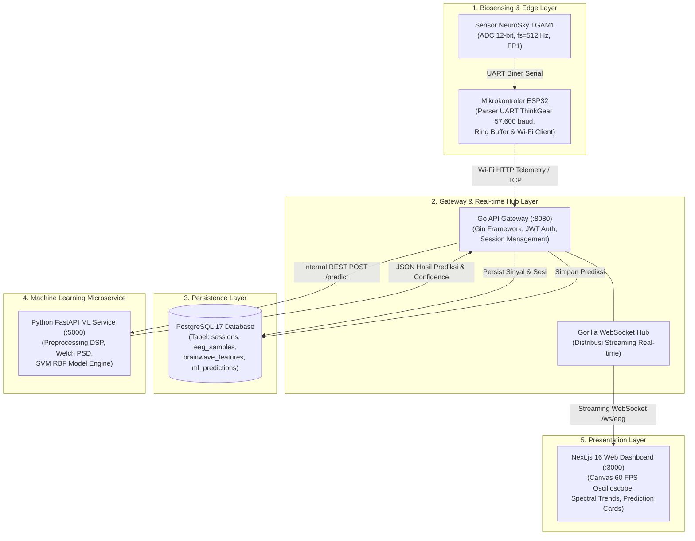
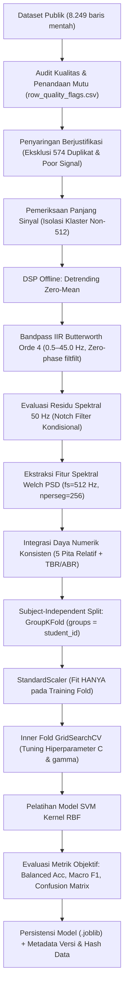

# PANDUAN METODOLOGI MACHINE LEARNING & PERSIAPAN SIDANG KOLOKIUM
## Sistem IoT Wearable EEG untuk Klasifikasi Pola Gelombang Otak

**Judul Tugas Akhir**: Rancang Bangun Perangkat IoT Wearable Berbasis EEG untuk Klasifikasi Pola Gelombang Otak Menggunakan Machine Learning  
**Penyusun / Mahasiswa**: Renaldi  
**Program Studi**: Teknologi Rekayasa Komputer, Sekolah Vokasi, Institut Pertanian Bogor (IPB University)  
**Komponen Sistem**: Microservice Machine Learning & Pengolahan Sinyal Biosinyal (`ml_service/`)  
**Versi Dokumen**: `v1.0-Kolokium-Release` | **Tanggal Penyusunan**: 25 Oktober 2026  
**Status Dokumen**: Dokumen Rujukan Akademik & Panduan Metodologi (Bukan Klaim Hasil Eksperimen Final)

---

## DAFTAR ISI LENGKAP

1. [Identitas dan Tujuan Dokumen](#1-identitas-dan-tujuan-dokumen)
2. [Konteks Penelitian Tugas Akhir dan Peran ML](#2-konteks-penelitian-tugas-akhir-dan-peran-ml)
3. [Arsitektur Sistem IoT EEG dan Batas Tanggung Jawab Setiap Komponen](#3-arsitektur-sistem-iot-eeg-dan-batas-tanggung-jawab-setiap-komponen)
4. [Pipeline ML End-to-End](#4-pipeline-ml-end-to-end)
5. [Sumber Dataset, Struktur, Lisensi, dan Keterbatasan](#5-sumber-dataset-struktur-lisensi-dan-keterbatasan)
6. [Definisi Target, Label, dan Pertimbangan Metodologis](#6-definisi-target-label-dan-pertimbangan-metodologis)
7. [Confounding, Berger Effect, dan Circular Labeling](#7-confounding-berger-effect-dan-circular-labeling)
8. [Audit Kualitas Dataset](#8-audit-kualitas-dataset)
9. [Preprocessing Sinyal EEG](#9-preprocessing-sinyal-eeg)
10. [Segmentasi dan Kurasi Rekaman](#10-segmentasi-dan-kurasi-rekaman)
11. [Ekstraksi Fitur EEG](#11-ekstraksi-fitur-eeg)
12. [Estimasi PSD Menggunakan Welch](#12-estimasi-psd-menggunakan-welch)
13. [Definisi Relative Band Power](#13-definisi-relative-band-power)
14. [Kandidat Model dan Baseline Pembanding](#14-kandidat-model-dan-baseline-pembanding)
15. [Strategi Pembagian Data Berbasis Subjek](#15-strategi-pembagian-data-berbasis-subjek)
16. [Pencegahan Data Leakage](#16-pencegahan-data-leakage)
17. [Metrik Evaluasi](#17-metrik-evaluasi)
18. [Kalibrasi Probabilitas dan Interpretasi Confidence](#18-kalibrasi-probabilitas-dan-interpretasi-confidence)
19. [Integrasi ML Service dengan Backend Go](#19-integrasi-ml-service-dengan-backend-go)
20. [Perbedaan Dataset Publik dan Prototipe TGAM1 + ESP32](#20-perbedaan-dataset-publik-dan-prototipe-tgam1--esp32)
21. [Keterbatasan Penelitian](#21-keterbatasan-penelitian)
22. [Risiko Teknis dan Mitigasi](#22-risiko-teknis-dan-mitigasi)
23. [Rencana Eksperimen Bertahap](#23-rencana-eksperimen-bertahap)
24. [Rencana Modularisasi ML Service](#24-rencana-modularisasi-ml-service)
25. [Rencana Presentasi Kolokium 10–12 Slide](#25-rencana-presentasi-kolokium-1012-slide)
26. [Pertanyaan Dosen dan Jawaban yang Dapat Dipertanggungjawabkan](#26-pertanyaan-dosen-dan-jawaban-yang-dapat-dipertanggungjawabkan)
27. [Daftar Keputusan yang Memerlukan Persetujuan Pembimbing](#27-daftar-keputusan-yang-memerlukan-persetujuan-pembimbing)
28. [Referensi dan Status Verifikasi Sumber](#28-referensi-dan-status-verifikasi-sumber)
29. [Checklist Kesiapan Kolokium](#29-checklist-kesiapan-kolokium)

---

## 1. IDENTITAS DAN TUJUAN DOKUMEN

Dokumen ini disusun sebagai panduan akademik resmi dalam rangka persiapan **Sidang Kolokium Tugas Akhir** pada Program Studi Teknologi Rekayasa Komputer, Sekolah Vokasi, Institut Pertanian Bogor. Fokus utama dokumen adalah membedah secara ilmiah dan teknis perancangan modul kecerdasan buatan dan pemrosesan biosinyal pada `ml_service/`.

Tujuan penyusunan dokumen ini adalah:
1. **Transparansi Metodologis**: Menjelaskan posisi machine learning secara objektif tanpa membuat klaim performa yang belum dibuktikan secara empiris pada data biosinyal manusia riil.
2. **Pemisahan Status Ilmiah**: Memisahkan secara tegas antara kode yang ada saat ini (yang dilaporkan audit masih berupa model sintetis dan placeholder), temuan audit empiris dataset publik, asumsi kerja operasional, dan rencana pengembangan pasca-kolokium.
3. **Kesiapan Sidang Kolokium**: Menyediakan rujukan komprehensif bagi mahasiswa untuk mempertahankan rancangan metodologi, mengantisipasi pertanyaan kritis dosen penguji, serta merumuskan poin-poin keputusan strategis yang memerlukan arahan dosen pembimbing.

---

## 2. KONTEKS PENELITIAN TUGAS AKHIR DAN PERAN ML

Penelitian tugas akhir ini merancang dan membangun sistem *IoT wearable biosensing* elektroensefalografi (EEG) kanal tunggal berbiaya terjangkau. Perangkat keras menggunakan sensor NeuroSky TGAM1 yang dihubungkan ke 3 kabel elektroda snap biopotensial yang ditempel langsung (FP1 aktif pada dahi anterior, referensi REF, dan ground GND tanpa klip telinga maupun headband kaku), yang dikendalikan oleh mikrokontroler ESP32 untuk transmisi data telemetri nirkabel.

### Peran Machine Learning
Machine Learning dalam sistem ini bertindak sebagai **agen pengenal pola spektral non-linear** dari biosinyal EEG domain frekuensi untuk membedakan kondisi eksperimental tugas kognitif terstruktur.

```
+----------------------------------------------------------------------------------------------------+
|                                    BATASAN SISTEM & ETIKA PENELITIAN                               |
+----------------------------------------------------------------------------------------------------+
| 1. ML BUKAN Pembaca Pikiran (Mind Reader)                                                          |
|    Model hanya memetakan pola distribusi energi relatif gelombang otak pada rentang frekuensi      |
|    tertentu (Delta, Theta, Alpha, Beta, Gamma).                                                    |
| 2. ML BUKAN Alat Diagnostik Medis                                                                  |
|    Hasil inferensi tidak memiliki validitas klinis untuk mendiagnosis gangguan neurologis, ADHD,   |
|    maupun depresi.                                                                                 |
| 3. ML Mengklasifikasikan Kondisi Eksperimen, BUKAN Pengukuran Langsung Variabel Psikologis Murni   |
|    Prediksi model terhadap tugas aritmetika mengidentifikasi perbedaan kondisi eksperimen yang     |
|    terkontrol, bukan mengukur besaran absolut "fokus", "stres", atau "beban kognitif" internal.   |
+----------------------------------------------------------------------------------------------------+
```

---

## 3. ARSITEKTUR SISTEM IOT EEG DAN BATAS TANGGUNG JAWAB SETIAP KOMPONEN

Sistem tugas akhir dirancang dalam lima lapisan arsitektur terdistribusi:



### Matriks Batas Tanggung Jawab Komponen

| Lapisan Sistem | Komponen Utama | Batas Tanggung Jawab Spesifik | Data Masuk | Data Keluar |
|---|---|---|---|---|
| **1. Biosensing Edge** | TGAM1 + ESP32 | • Akuisisi tegangan analog EEG.<br>• Ekstraksi paket biner ThinkGear (`0xAA 0xAA`).<br>• Transmisi data mentah time-series via Wi-Fi. | Gelombang mikrovolt kulit kepala | Deret integer mentah ADC (16-bit 2's complement) |
| **2. Gateway Hub** | Go Backend (:8080) | • Manajemen sesi perekaman pengguna.<br>• Buffer aliran data streaming.<br>• Orkestrator panggilan ke layanan ML.<br>• Broadcast data via WebSocket murni. | Sinyal dari ESP32 atau simulator | Format JSON terstruktur ke database & frontend |
| **3. Basis Data** | PostgreSQL 17 | • Penyimpanan relasional jangka panjang.<br>• Audit trail sesi perekaman.<br>• Persistensi hasil klasifikasi ML. | Data sesi, fitur, prediksi | Query analitik & riwayat dashboard |
| **4. ML Service** | Python FastAPI (:5000) | • Validasi integritas sinyal masukan.<br>• Preprocessing digital (detrending, filtering).<br>• Estimasi densitas spektral daya (Welch PSD).<br>• Prediksi kelas SVM RBF terkalibrasi. | Vektor sinyal mentah time-series atau fitur 5 pita | JSON hasil klasifikasi, confidence, dan fitur |
| **5. Presentasi** | Next.js 16 Dashboard | • Rendering visual sinyal gelombang 60 FPS.<br>• Visualisasi radar chart relative band power.<br>• Penampil kartu kesimpulan pola gelombang. | Stream WebSocket & REST API Go | Antarmuka pengguna interaktif |

---

## 4. PIPELINE ML END-TO-END

Untuk mencegah bias dan kerancuan metodologis, alur kerja machine learning dipisahkan secara tegas antara **fase pelatihan offline** dan **fase inferensi online real-time**:

### A. Alur Pelatihan Model Offline (Offline Training Pipeline)



### B. Alur Inferensi Online Real-time (Online Inference Pipeline)

```mermaid
flowchart LR
    A1["ESP32 / Simulator"] -->|Streaming 512 Hz| B1["Go API Gateway"]
    B1 -->|Buffer Jendela 1 Detik (512 sampel)| C1["FastAPI POST /predict"]
    C1 --> D1["Validasi Skema & Nilai Finite"]
    D1 --> E1["Detrending & Causal Filtering<br/>(Mitigasi Transien Tepi)"]
    E1 --> F1["Welch PSD Ekstraksi Fitur<br/>(Parameter & Bin Identik Training)"]
    F1 --> G1["StandardScaler Transform<br/>(Parameter Mean & Var Training)"]
    G1 --> H1["SVM Predict & Decision Function"]
    H1 --> I1["JSON Response (Kelas, Confidence, Fitur)"]
    I1 --> J1["Go Backend -> PostgreSQL & WebSocket"]
    J1 --> K1["Next.js Dashboard Display"]
```

> **Prinsip Anti-Skew (*Training-Serving Skew Prevention*)**:  
> Fungsi matematika, panjang window, fungsi jendela, alokasi bin frekuensi, batas integrasi spektral, dan parameter penskalaan (`StandardScaler`) yang digunakan saat inferensi real-time **WAJIB IDENTIK SECARA MATEMATIS** dengan pipeline saat pelatihan offline.

---

## 5. SUMBER DATASET, STRUKTUR, LISENSI, DAN KETERBATASAN

### Identitas Dataset Publik
- **Nama File**: `merged_eeg_datas_50_subjects.csv`
- **Penyedia / Asal Data**: Repositori publik Mendeley Data, disusun oleh periset dari Chittagong University of Engineering and Technology (CUET), Bangladesh (2025).
- **Ukuran File**: 19.029.871 bytes (~19.03 MB).
- **Dimensi Baris & Kolom**: Tepat 8.249 baris rekaman dan 23 kolom data.
- **Jumlah Partisipan**: Teridentifikasi **51 subjek unik** (`student_id` bernilai 1 hingga 51), bukan 50 subjek sebagaimana nama file dataset.

### Kamus Kolom Dataset

| Kategori Kolom | Nama Kolom | Tipe Data | Definisi Fungsional |
|---|---|---|---|
| **Identitas Subjek** | `student_id` | Integer | ID numerik unik partisipan eksperimen (1 s.d. 51). |
| **Kondisi Eksperimen** | `task_id` | Integer / String | Indikator jenis tugas eksperimen (Task 1, Task 2, Task 3). |
| | `workload_score` | Float | Skor beban kerja kognitif subjektif subjek. |
| | `is_correct` | Boolean / Int | Indikator ketepatan jawaban tugas aritmetika. |
| **Waktu Perekaman** | `created_at` | Timestamp | Waktu logging rekaman ke database bridge. |
| **Sinyal Mentah** | `neuro_raw_eeg` | String (JSON Array) | Deret sampel sinyal tegangan mentah domain waktu integer. |
| **Indikator Kontak** | `neuro_poor_signal_strength` | Integer | Indikator kontak elektroda (0 = kontak baik; >0 = kontak buruk). |
| **Daya Spektral ASIC** | `neuro_delta`, `neuro_theta`, `neuro_alpha`, `neuro_beta`, `neuro_gamma` | Float | Daya pita spektral bawaan hasil kalkulasi hardware chip. |
| **Target Bawaan** | `neuro_dominan_rhythm` | String | Label ritme dominan bawaan (Alpha, Beta, Theta, Delta, Mixed). |

### Status Lisensi & Verifikasi Primer
- **Status Lisensi**: Berdasarkan dokumen laporan proyek awal, dataset diklaim berlisensi *Creative Commons Attribution 4.0 International (CC BY 4.0)*. Status verifikasi primer: ⚠️ **BELUM DIVERIFIKASI LANGSUNG KE WEBPAGE RESMI MENDELEY DATA**.
- **DOI Rujukan**: Tercatat `10.17632/gy4sbnn389.1`. Status: ⚠️ **TERCANTUM DALAM LAPORAN LOKAL; WAJIB DIVERIFIKASI SEBELUM TULISAN SKRIPSI FINAL**.

### Keterbatasan Ilmiah Dataset Publik
1. **Perekaman Kanal Tunggal Frontal**: Sinyal hanya direkam dari dahi (FP1), sehingga tidak memiliki resolusi spasial untuk memetakan dinamika lobus parietal, oksipital, atau temporal.
2. **Artefak Kedipan Mata (EOG)**: Posisi elektroda di dahi tepat di atas mata menyebabkan sinyal sangat rentan terkontaminasi potensial aksi kedipan mata dan gerakan bola mata.
3. **Informasi Protokol Terbatas**: Durasi rekaman per subjek relatif singkat (~60 detik per sesi tugas), dan rincian teknis mengenai impedansi kontak elektroda tidak tercatat.

---

## 6. DEFINISI TARGET, LABEL, DAN PERTIMBANGAN METODOLOGIS

### Penolakan Mutlak Target Bawaan (`neuro_dominan_rhythm`)
Hasil audit komputasional membuktikan bahwa nilai pada kolom `neuro_dominan_rhythm` memiliki kesesuaian sebesar **99.66%** dengan hasil operasi matematis $\text{argmax}$ terhadap kolom relative band power bawaan.
- **Konsekuensi Metodologis**: Melatih model machine learning dengan fitur input relative band power untuk memprediksi `neuro_dominan_rhythm` adalah **kesalahan ilmiah fatal (*circular classification* / tautologi murni)**. Model hanya mempelajari kembali fungsi $\text{argmax}$ sederhana, bukan mengenali pola fisiologis otak yang independen.
- **Keputusan**: Target `neuro_dominan_rhythm` **RESMI DITOLAK MUTLAK**.

### Kandidat Target Klasifikasi yang Sah: `task_id`
Variabel `task_id` merepresentasikan kondisi tugas eksperimen yang diberikan kepada partisipan saat perekaman berlangsung. Distribusi kelas pada dataset relatif berimbang:
- **Task 1**: 2.730 baris (~33.1%)
- **Task 2**: 2.756 baris (~33.4%)
- **Task 3**: 2.763 baris (~33.5%)

```
+----------------------------------------------------------------------------------------------------+
|                             FORMULASI KANDIDAT TARGET UNTUK KOLOKIUM                               |
+----------------------------------------------------------------------------------------------------+
| KANDIDAT A: Klasifikasi Biner Kondisi Eksperimen (DIREKOMENDASIKAN UNTUK STUDI AWAL)               |
| • Kelas 0: Task 1 (Resting Baseline, Kondisi Istirahat Mata Tertutup, 60 detik)                    |
| • Kelas 1: Task 2 & Task 3 (Active Arithmetic Tasks, Kondisi Pengerjaan Matematika Aktif)           |
|                                                                                                    |
| KANDIDAT B: Klasifikasi Tiga Tingkat Kondisi Eksperimen                                            |
| • Kelas 0: Task 1 (Resting Baseline)                                                               |
| • Kelas 1: Task 2 (Aritmetika Tingkat Sedang)                                                      |
| • Kelas 2: Task 3 (Aritmetika Tingkat Sulit)                                                       |
+----------------------------------------------------------------------------------------------------+
```

*Catatan Status*: Kedua kandidat ini berstatus sebagai **usulan metodologis yang belum final** dan disiapkan untuk dikonsultasikan serta diputuskan bersama Dosen Pembimbing saat Kolokium.

---

## 7. CONFOUNDING, BERGER EFFECT, DAN CIRCULAR LABELING

Dalam perancangan machine learning berbasis EEG, pengenalan terhadap faktor pembaur (*confounding factors*) adalah syarat mutlak keabsahan penelitian:

### A. Analisis Kritis Faktor Pembaur: Fenomena Fisiologis *Berger Effect*
- **Latar Belakang Fisiologis**: Pada tahun 1929, penemu EEG Hans Berger mendokumentasikan bahwa ketika seseorang menutup mata dalam keadaan tenang, osilasi gelombang Alpha ($8.0 - 13.0\text{ Hz}$) pada korteks serebral mengalami sinkronisasi masif sehingga amplitudonya meningkat drastis (*Alpha synchronization*). Sebaliknya, saat mata dibuka, masuknya cahaya dan stimulasi visual ke retina segera memicu desinkronisasi atau pemblokiran gelombang Alpha (*Alpha desynchronization / blocking*).
- **Kondisi Eksperimen Dataset Mendeley**:
  - Pada **Task 1**, protokol eksperimen mencatat subjek berada dalam kondisi **Mata Tertutup (*Eyes-Closed*)**.
  - Pada **Task 2 dan Task 3**, subjek mengerjakan soal matematika di layar dengan kondisi **Mata Terbuka (*Eyes-Open*)**.
- **Risiko Pembaur (*Confounder Risk*)**:
  Perbedaan spektral daya gelombang Alpha antara Task 1 dan Task 2/3 berisiko tinggi **hanya merefleksikan perbedaan kondisi mata tertutup versus mata terbuka**, BUKAN murni beban kognitif aritmetika. Model ML dapat dengan mudah mencapai akurasi tinggi hanya dengan mendeteksi ada/tidaknya *Berger Effect*.
- **Mitigasi Akademik untuk Kolokium**:
  1. Mahasiswa wajib memaparkan potensi pembaur *Berger Effect* ini secara jujur di hadapan dewan penguji.
  2. Menegaskan bahwa klasifikasi Task 1 vs Task 2/3 adalah klasifikasi kondisi eksperimen multivariat, bukan bukti tunggal pengukuran "beban kognitif murni".
  3. Mengusulkan verifikasi dokumen primer publikasi CUET untuk meneliti apakah periset menyediakan sesi istirahat mata terbuka (*eyes-open baseline*) sebagai pembanding.

### B. Faktor Pembaur Sesi, Subjek, dan Efek Kelelahan
- **Impedansi Kontak Elektroda**: Ketebalan kulit, kelembapan dahi, dan tekanan elektroda berbeda drastis antar-subjek. Jika pembagian data latih dan uji tidak diisolasi per subjek, model akan mengenali "ciri khas subjek" daripada pola gelombang tugas.
- **Urutan Pengerjaan Tugas**: Pengerjaan Task 1 selalu mendahului Task 2 dan Task 3, sehingga efek kelelahan kognitif (*mental fatigue*) atau kebosanan dapat bercampur baur dengan efek kesulitan tugas.

---

## 8. AUDIT KUALITAS DATASET

Audit komputasional *read-only* terhadap `merged_eeg_datas_50_subjects.csv` mengungkap 5 anomali empiris utama:

| No | Temuan Anomali Empiris | Kuantitas Data Terdampak | Status Penyebab Ilmiah | Tindakan Metodologis yang Direncanakan |
|---|---|---|---|---|
| 1 | **Duplikasi Baris Identik Persis** | 574 baris rekaman | ⚠️ **Belum Terverifikasi** (Dugaan retry software atau race condition database bridge) | Dieliminasi dari himpunan training model guna mencegah *sample redundancy bias*. |
| 2 | **Nilai Ekstrem Batas Bawah ADC (-2048)** | 33.327 kemunculan pada 180 baris rekaman | ⚠️ **Belum Terverifikasi** (Batas bawah integer 12-bit bertanda; bukan bukti pasti kerusakan fisik sensor) | Diberikan penanda mutu `has_adc_extreme_val`; dieksklusikan dari analisis sinyal bersih. |
| 3 | **Sampel di Luar Batas Normal 12-bit** | 2 baris rekaman (amplitudo mencapai 9.733) | ⚠️ **Belum Terverifikasi** (Anomali numerik integer) | Diberikan penanda mutu; dieksklusikan dari subset training. |
| 4 | **Sampel Berpasangan Identik Genap-Ganjil** | 428 baris rekaman (termasuk seluruh 276 baris $N=1024$) | ⚠️ **Belum Terverifikasi** (Dugaan zero-order hold upsampling atau replikasi buffer UART) | Ditandai dalam metadata kualitas untuk dianalisis kestabilan spektralnya. |
| 5 | **Kelompok Deret Sinyal Berulang** | 29 kelompok baris (sinyal mentah identik, band power berbeda) | ⚠️ **Belum Terverifikasi** (Terjadi pada subjek, task, dan timestamp identik) | Ditandai dalam audit log; diinvestigasi keterkaitannya dengan latensi perhitungan chip. |

### Prinsip Penandaan Mutu Data (*Quality Flagging*) vs Penghapusan Fisik
- **Quality Indexing**: Seluruh 8.249 baris mentah tetap dipertahankan pada data mentah dan dicatat status mutunya dalam file audit `row_quality_flags.csv`.
- **Eksklusi Berjustifikasi**: Keputusan untuk mengeluarkan baris dari pelatihan model harus disertai justifikasi eksplisit dan log pencatatan komputasional (*data provenance log*), bukan penghapusan data secara diam-diam.

---

## 9. PREPROCESSING SINYAL EEG

Tahapan pengolahan sinyal digital (DSP) dirancang untuk memisahkan biosinyal serebral dari derau lingkungan dan artefak biologis:

### 1. Detrending / Zero-Mean Centering
Menghilangkan offset tegangan DC yang diakibatkan oleh potensial kontak elektrokimia elektroda-kulit:
$$x_{\text{zero}}[n] = x[n] - \frac{1}{N}\sum_{k=0}^{N-1}x[k]$$

### 2. Bandpass Filtering IIR Butterworth (0.5 – 45.0 Hz)
- **Karakteristik Desain**: Filter IIR Butterworth Orde 4 dipilih karena memiliki respons frekuensi yang paling datar pada daerah lolos (*maximally flat passband*), meminimalkan distorsi amplitudo gelombang fisiologis.
- **Status Parameter**: Rentang $0.5 - 45.0\text{ Hz}$ berstatus sebagai **parameter perancangan sementara** yang akan dievaluasi kurva respons frekuensinya (*Bode plot*) terhadap spektrum sinyal riil.
- **Implementasi Training Offline**: Diterapkan dua arah (*forward-backward filtering* via `scipy.signal.filtfilt`) untuk memastikan **pergeseran fase bernilai nol (*zero-phase filtering*)**.
- **Pita Frekuensi Terbatas**: Pembatasan cut-off atas pada $45.0\text{ Hz}$ secara eksplisit mendefinisikan analisis gelombang Gamma dalam penelitian ini sebagai **Gamma terbatas ($30.0 - 45.0\text{ Hz}$)**.

### 3. Evaluasi Notch Filter 50 Hz (Kondisional)
- Filter bandpass Orde 4 dengan cut-off $45.0\text{ Hz}$ secara inheren memberikan pelemahan pada frekuensi jala-jala listrik 50 Hz.
- **Penerapan notch filter 50 Hz BUKAN keharusan otomatis**. Penerapan filter notch sempit berisiko menimbulkan distorsi fase lokal dan osilasi dering (*ringing artifacts*).
- **Kriteria Keputusan**: Notch filter 50 Hz ($Q=30$) hanya akan diaktifkan apabila hasil inspeksi kurva PSD pasca-bandpass masih menunjukkan tonjolan spektral tajam (*powerline spike*) pada 50 Hz.

### 4. Keterbatasan `filtfilt` pada Inferensi Real-time
Filter dua arah `filtfilt` bersifat non-kausal karena membutuhkan deret sampel lengkap ke masa depan. Penerapan `filtfilt` pada buffer jendela geser (*sliding window*) online real-time akan memicu **distorsi transien tepi (*edge transient distortion*)** pada awal dan akhir jendela.
- **Mitigasi Rekayasa**: Untuk inferensi real-time berkelanjutan, sistem dirancang menggunakan **filter IIR kausal searah dengan pelestarian status kondisi awal (*initial conditions buffer* via `scipy.signal.lfilter`)** atau mekanisme jendela bertumpang tindih (*overlapped sliding window*) dengan pembuangan margin transien tepi.

---

## 10. SEGMENTASI DAN KURASI REKAMAN

### Analisis Panjang Sinyal Non-512 (2.060 Baris Data)
Audit membuktikan bahwa dari 8.249 baris rekaman, sebanyak 2.060 baris memiliki panjang bukan 512 sampel. Komposisi panjang sampel mencakup:
- **Klaster Multi-Detik**: 276 baris berpanjang ~1.024 sampel dan 432 baris berpanjang ~1.536 sampel.
- **Klaster Jitter Minor**: Ratusan baris berpanjang 468–511 sampel (durasi ~0.91–0.99 detik).

### Prinsip Metodologis Segmentasi
1. **Dilarang Melakukan Pemotongan Buta (*No Blind Truncation*)**: Pemotongan otomatis semua baris menjadi 512 sampel pertama dilarang keras, karena pada baris berpanjang 1.024 dan 1.536 sampel, tindakan ini membuang 50% hingga 66% data fisiologis valid.
2. **Korelasi Durasi Fisik**: Hubungan panjang sampel ($N$), durasi fisik ($T$), dan sampling rate ($f_s = 512\text{ Hz}$):
   $$T = \frac{N}{f_s} \implies N=512 (1.0\text{ s}),\quad N=1024 (2.0\text{ s}),\quad N=1536 (3.0\text{ s})$$
3. **Prosedur Kurasi**:
   - Klaster multi-detik dianalisis sebagai segmen multi-detik utuh menggunakan Welch PSD (memberikan estimasi spektral lebih stabil karena memiliki 7 hingga 11 sub-jendela), atau dipecah (*segmented*) menjadi jendela 1 detik non-overlapping.
   - Klaster jitter minor dapat diproses langsung oleh metode Welch dengan panjang sub-jendela $\text{nperseg} = 256$ sampel tanpa distorsi.

---

## 11. EKSTRAKSI FITUR EEG

Fitur yang diekstraksi dari sinyal domain waktu adalah distribusi daya spektral pada lima pita frekuensi biologis standar:

| Pita Gelombang | Rentang Frekuensi Operasional | Fenomena Fisiologis Terkait (Konteks Non-Klinis) | Status dalam Model |
|---|---|---|:---:|
| **Delta ($\delta$)** | $0.5 - 4.0\text{ Hz}$ | Gelombang lambat; dominan pada fase tidur nyenyak atau artefak kedipan mata. | Fitur Primer |
| **Theta ($\theta$)** | $4.0 - 8.0\text{ Hz}$ | Keadaan kantuk, meditasi, pemrosesan memori kerja, dan penurunan kewaspadaan. | Fitur Primer |
| **Alpha ($\alpha$)** | $8.0 - 13.0\text{ Hz}$ | Kondisi rileks terjaga; tersinkronisasi masif saat mata tertutup (*Berger Effect*). | Fitur Primer |
| **Beta ($\beta$)** | $13.0 - 30.0\text{ Hz}$ | Aktivitas kognitif aktif, konsentrasi mental, pemecahan masalah aritmetika. | Fitur Primer |
| **Gamma Terbatas ($\gamma$)** | $30.0 - 45.0\text{ Hz}$ | Integrasi perseptual dan pemrosesan informasi tingkat tinggi (dibatasi 45 Hz). | Fitur Primer |
| **Theta/Beta Ratio (TBR)** | $\text{Power}(\theta) / \text{Power}(\beta)$ | Fitur eksploratif rasio spektral keterlibatan kognitif. | Fitur Eksploratif |
| **Alpha/Beta Ratio (ABR)** | $\text{Power}(\alpha) / \text{Power}(\beta)$ | Fitur eksploratif indeks relaksasi vs beban kerja kognitif. | Fitur Eksploratif |

---

## 12. ESTIMASI PSD MENGGUNAKAN WELCH

Estimasi Rapat Spektral Daya (*Power Spectral Density* / PSD) dihitung menggunakan metode modifikasi periodogram rata-rata Welch (1967):

### Parameter Estimasi Spektral
- Frekuensi sampling kerja: $f_s = 512\text{ Hz}$ (asumsi kerja yang perlu diverifikasi).
- Panjang sub-jendela segmentasi: $\text{nperseg} = 256$ sampel (durasi jendela temporal 0.5 detik).
- Tumpang tindih sub-jendela: $\text{noverlap} = 128$ sampel (overlap 50%).
- Fungsi jendela: Jendela Hann atau Hamming untuk meminimalkan *spectral leakage*.

### Resolusi Frekuensi Grid Diskrit vs Batas Pita Kontinu
Resolusi frekuensi grid diskrit yang dihasilkan oleh transformasi Fourier pada jendela 256 sampel adalah:
$$\Delta f = \frac{f_s}{\text{nperseg}} = \frac{512\text{ Hz}}{256} = 2.0\text{ Hz}$$
Daftar bin frekuensi diskrit yang terbentuk:
$$f_k = k \times 2.0\text{ Hz} = [0, 2, 4, 6, 8, 10, 12, 14, \dots, 256]\text{ Hz}$$

```
+----------------------------------------------------------------------------------------------------+
|                      ANALISIS BATAS KONTINU PADA GRID DISKRIT 2.0 HZ                               |
+----------------------------------------------------------------------------------------------------+
| Batas fisiologis kontinu standar:                                                                  |
| • Delta: 0.5 – 4.0 Hz | Theta: 4.0 – 8.0 Hz | Alpha: 8.0 – 13.0 Hz | Beta: 13.0 – 30.0 Hz          |
| • Gamma Terbatas: 30.0 – 45.0 Hz                                                                   |
|                                                                                                    |
| Keterbatasan Grid Diskrit:                                                                         |
| Batas 0.5 Hz, 13.0 Hz, dan 45.0 Hz TIDAK JATUH TEPAT PADA GRID GENAP 2.0 HZ.                     |
|                                                                                                    |
| Metode Integrasi yang Ditetapkan:                                                                  |
| 1. Pendekatan Riemann Rectangular Sum:                                                             |
|    Setiap bin fk merepresentasikan interval lebar [fk - 1.0, fk + 1.0) Hz.                         |
|    • Delta (bin 2 Hz)  -> representasi efektif [1.0, 3.0) Hz.                                      |
|    • Theta (bin 4, 6 Hz) -> representasi efektif [3.0, 7.0) Hz.                                    |
|    • Alpha (bin 8, 10, 12 Hz) -> representasi efektif [7.0, 13.0) Hz (tepat di batas 13 Hz).      |
|    • Beta (bin 14, 16, ..., 28 Hz) -> representasi efektif [13.0, 29.0) Hz.                        |
|    • Gamma Terbatas (bin 30, 32, ..., 44 Hz) -> representasi efektif [29.0, 45.0) Hz.             |
| 2. Pendekatan Composite Trapezoid dengan Interpolasi Linear:                                       |
|    Menginterpolasi kurva PSD pada batas eksak (0.5, 4.0, 8.0, 13.0, 30.0, 45.0 Hz) sebelum        |
|    menghitung luas trapesium numerik via scipy.integrate.trapezoid.                                |
+----------------------------------------------------------------------------------------------------+
```

---

## 13. DEFINISI RELATIVE BAND POWER

Untuk menstandarisasi fitur spektral antar-rekaman, daya mutlak pada setiap sub-pita dinormalisasi terhadap daya total:

### Formula Daya Total Konsisten
Daya total ($P_{\text{total}}$) didefinisikan secara konsisten sebagai jumlahan daya dari kelima sub-pita frekuensi yang dianalisis:
$$P_{\text{total}} = P_{\delta} + P_{\theta} + P_{\alpha} + P_{\beta} + P_{\gamma\text{-terbatas}}$$
Daya relatif untuk setiap sub-pita $b$ dihitung sebagai persentase:
$$\text{Relative Band Power}_b = \left( \frac{P_b}{P_{\text{total}}} \right) \times 100\%$$

### Penjaminan Analitik & Penanganan Nilai Tak Valid
1. **Penjaminan Analitik**: Definisi ini menjamin secara matematis dan numerik bahwa:
   $$\sum_{b \in \{\delta, \theta, \alpha, \beta, \gamma\}} \text{Relative Band Power}_b \equiv 100.0\%$$
2. **Penanganan Denominator Nol / Sinyal Flat**: Apabila sinyal mentah berupa garis datar (*flatline*) atau $P_{\text{total}} \le 10^{-12}$, fungsi ekstraksi fitur tidak memicu *ZeroDivisionError*, melainkan menandai rekaman sebagai *invalid signal* dan mengembalikan nilai proporsional netral ($20.0\%$ per pita) disertai flag peringatan kualitas.
3. **Batasan Klaim Fisiologis**: Normalisasi daya relatif mereduksi sebagian variasi amplitudo global, tetapi **tidak meniadakan variasi resistansi kontak elektroda** atau perbedaan impedansi jaringan kulit kepala.

---

## 14. KANDIDAT MODEL DAN BASELINE PEMBANDING

Pemilihan algoritma klasifikasi didasarkan pada perbandingan multi-model terstruktur:

| Model | Peran Metodologis | Keunggulan Ilmiah | Parameter Kunci yang Direncanakan |
|---|---|---|---|
| **Dummy Classifier** | Baseline Batas Bawah | Menetapkan batas performa peluang acak (*chance-level baseline*) berdasarkan distribusi kelas mayoritas. | `strategy="stratified"` / `"most_frequent"` |
| **Logistic Regression (L2)** | Baseline Linear | Model linear teratur sederhana untuk menguji apakah batas keputusan antar-kelas dapat dipisahkan secara linear. | `penalty="l2"`, `C=1.0`, `solver="lbfgs"` |
| **Support Vector Machine (SVM RBF)** | **Kandidat Model Primer** | Efektif pada ruang fitur biosinyal berdimensi rendah-menengah ($D \approx 5-7$); margin optimal memaksimalkan separasi non-linear. | Kernel RBF, tuning parameter penalti $C$ dan lebar kernel $\gamma$. |
| **Random Forest** | Baseline Non-Parametrik | Mampu menangkap interaksi non-linear kompleks antar-fitur tanpa asumsi distribusi tertentu. | `n_estimators=100`, `max_depth=4..8` |

---

## 15. STRATEGI PEMBAGIAN DATA BERBASIS SUBJEK

```
+----------------------------------------------------------------------------------------------------+
|                    LARANGAN MUTLAK RANDOM SHUFFLE SPLIT PADA BIOSINYAL                             |
+----------------------------------------------------------------------------------------------------+
| Pemisahan data acak biasa (Random K-Fold / train_test_split per baris) DILARANG KERAS.             |
| Alasan: Rekaman EEG dari subjek yang sama memiliki korelasi temporal dan karakteristik impedansi    |
| identik. Jika baris diacak biasa, jendela waktu dari subjek yang sama akan masuk ke fold latih     |
| dan fold uji sekaligus. Ini memicu INTER-SUBJECT DATA LEAKAGE yang menghasilkan akurasi            |
| optimistik palsu dan model akan gagal total saat diuji pada orang baru.                            |
+----------------------------------------------------------------------------------------------------+
```

### Protokol Evaluasi Berbasis Subjek Independen (*Subject-Independent Evaluation*)
- **Skema Validasi**: Menggunakan `GroupKFold(n_splits=5)` atau `StratifiedGroupKFold` dengan parameter pengelompokan `groups = student_id`.
- **Jaminan Isolasi**: Seluruh rekaman dari subjek yang berada di fold uji **TIDAK PERNAH DILIHAT** oleh model selama proses pelatihan di fold latih.
- **Syarat `StratifiedGroupKFold`**: Memerlukan scikit-learn $\ge 1.0$ dan verifikasi awal bahwa setiap subjek memiliki distribusi kelas yang memungkinkan pembagian fold seimbang tanpa memecah kesatuan grup subjek.

---

## 16. PENCEGAHAN DATA LEAKAGE

Untuk memastikan integritas ilmiah, protokol isolasi informasi diterapkan secara ketat:

1. **Encapsulated Pipeline Transformasi**:
   Penskalaan fitur menggunakan `StandardScaler` WAJIB dibungkus di dalam `sklearn.pipeline.Pipeline`.
   - Perhitungan mean ($\mu$) dan variansi ($\sigma^2$) HANYA dieksekusi pada data training fold (`pipeline.fit(X_train, y_train)`).
   - Data testing fold HANYA ditransformasikan menggunakan parameter dari training fold tersebut (`pipeline.transform(X_test)`).
2. **Penyetelan Hiperparameter Bebas Kebocoran (*Nested Cross-Validation*)**:
   - Penyetelan parameter $C$ dan $\gamma$ pada SVM tidak boleh menggunakan data uji final.
   - Penyetelan dilakukan menggunakan *Inner Cross-Validation* di dalam fold latih (*inner fold GridSearchCV*).
   - *Outer Cross-Validation* digunakan secara murni untuk mengestimasi kemampuan generalisasi model final terhadap subjek baru.

---

## 17. METRIK EVALUASI

Pelaporan performa model tidak boleh hanya mengandalkan nilai *accuracy* sederhana:

1. **Balanced Accuracy**: Menghitung rerata dari nilai recall pada masing-masing kelas guna mengantisipasi sedikit variasi proporsi sampel antar-tugas.
2. **Macro-averaged F1-Score**: Rerata F1-score tanpa pembobotan frekuensi kelas, memberikan bobot kepentingan yang setara untuk setiap kondisi tugas.
3. **Precision & Recall per Kelas**: Mengukur tingkat kepastian prediksi dan sensitivitas model pada masing-masing kondisi tugas.
4. **Confusion Matrix Multi-Kelas**: Menganalisis sebaran kesalahan klasifikasi antar-kondisi tugas (misal: seberapa sering Task 2 tertukar dengan Task 3).
5. **Pelaporan Variasi Skor Antar-Fold**: Metrik wajib dilaporkan dalam bentuk rerata dan deviasi standar ($\mu \pm \sigma$) dari ke-5 fold evaluasi subjek independen, bukan hanya angka tunggal tertinggi.

---

## 18. KALIBRASI PROBABILITAS DAN INTERPRETASI CONFIDENCE

- **Status Nilai Keputusan SVM**: Jarak sampel ke *hyperplane* pemisah (*decision function*) pada SVM bukan merupakan probabilitas kebenaran yang terkalibrasi (*uncalibrated margin score*).
- **Mekanisme Kalibrasi Formal**: Apabila antarmuka IoT membutuhkan persentase keyakinan prediksi (*confidence score*), kalibrasi wajib diterapkan menggunakan metode regresi logistik out-of-fold (Platt Scaling via `CalibratedClassifierCV`).
- **Evaluasi Kalibrasi**: Kualitas probabilitas yang dihasilkan harus diuji menggunakan kurva kalibrasi (*reliability diagram*) dan metrik *Brier Score*.
- **Batasan Interpretasi**: Nilai confidence tinggi tidak boleh diklaim sebagai bukti kepastian diagnosis medis, melainkan tingkat kesesuaian matematis fitur sinyal dengan batas keputusan model.

---

## 19. INTEGRASI ML SERVICE DENGAN BACKEND GO

### Kontrak Endpoint API (`POST /predict`)
Berdasarkan audit basis kode aktual, kontrak komunikasi antara Go API Gateway dan FastAPI ML Service adalah sebagai berikut:

```json
// Payload Permintaan (Request Body ke POST /predict)
{
  "session_id": "ses-001-uuid",
  "model_name": "svm",
  "features": {
    "delta": 24.5,
    "theta": 18.2,
    "alpha": 42.1,
    "beta": 11.2,
    "gamma": 4.0
  },
  "raw_samples": [ /* Opsional: deret 512 sampel integer mikrovolt */ ]
}
```

```json
// Payload Respons (Response Body dari POST /predict)
{
  "session_id": "ses-001-uuid",
  "model_name": "Support Vector Machine (SVM)",
  "model_version": "v1.0.0-academic",
  "training_dataset_version": "Mendeley-CUET-v1",
  "predicted_class": "Task 1 (Resting Baseline)",
  "confidence": 0.8421,
  "class_probabilities": {
    "Task 1 (Resting Baseline)": 0.8421,
    "Task 2/3 (Active Mental Task)": 0.1579
  },
  "features": {
    "delta": 24.5, "theta": 18.2, "alpha": 42.1, "beta": 11.2, "gamma": 4.0
  },
  "processed_at": "2026-10-25T01:00:00Z"
}
```

### Penanganan Status Model yang Belum Tersedia
- **Larangan Prediksi Tiruan**: Jika model riil belum dilatih atau file model tidak ditemukan, endpoint `POST /predict` **WAJIB mengembalikan status HTTP 503 Service Unavailable** disertai detail penjelasan teknis. Dilarang menghasilkan prediksi tiruan (*mock output*) hanya untuk membuat antarmuka dashboard tampak aktif.
- **Koreksi Fallback Backend Go**: Kode fallback lokal pada Go backend (`backend/internal/analysis/handler.go` baris 146–201) yang sebelumnya melabeli aturan heuristik argmax sebagai "Support Vector Machine (SVM) v1.2.0-rbf-kernel" dengan confidence statis 0.942 dicatat sebagai anomali arsitektur yang perlu diselaraskan.

---

## 20. PERBEDAAN DATASET PUBLIK DAN PROTOTIPE TGAM1 + ESP32

Untuk menjaga kejujuran akademik, perbedaan karakteristik antara dataset publik Mendeley dan prototipe hardware mandiri dipetakan secara terperinci:

| Parameter Karakteristik | Dataset Publik (Mendeley Data CUET) | Prototipe Hardware Mandiri (TGAM1 + ESP32) |
|---|---|---|
| **Lokasi & Subjek Perekaman** | 51 mahasiswa di Bangladesh (CUET, 2025). | Pengujian sukarelawan lokal di lingkungan kampus IPB. |
| **Frekuensi Sampling ($f_s$)** | **Asumsi kerja: 512 Hz** (belum ada konfirmasi resmi di teks Mendeley). | **Spesifikasi resmi: 512 Hz** (dikontrol kristal osilator internal chip TGAM1). |
| **Format Sinyal Mentah** | String JSON array berisi integer bertanda (rentang $-2048$ hingga $9733$). | Paket biner serial ThinkGear Protocol (Header `0xAA 0xAA`, Payload Code `0x80`, 16-bit 2's complement). |
| **Media Transmisi & Logging** | Koneksi nirkabel Bluetooth ke database MySQL melalui aplikasi bridge lokal. | UART Hardware serial (GPIO16/17, 57.600 baud, 8N1) ke mikrokontroler ESP32 via Wi-Fi telemetri. |
| **Kondisi Pengujian Sinyal** | Perekaman sesi eksperimen terkontrol (Task 1, 2, 3) selama ~60 detik per tugas. | Sesi live monitoring real-time terintegrasi dengan web dashboard Canvas Next.js 16. |
| **Karakteristik Derau (*Noise Floor*)** | Lingkungan laboratorium kampus Bangladesh; kondisi grounding tidak terdokumentasi. | Regulasi catu daya baterai Li-Po 3.7V + LDO AMS1117-3.3V dengan ground terpisah. |

> **Prinsip Metodologis**: Performa klasifikasi pada dataset publik Mendeley berkedudukan sebagai **studi kelayakan metodologis awal (*preliminary feasibility study*)**. Hasilnya tidak dapat dijamin akan identik secara otomatis dengan sinyal dari prototipe alat fisik mandiri tanpa pengujian empiris langsung.

---

## 21. KETERBATASAN PENELITIAN

Keterbatasan-keterbatasan berikut diakui secara jujur sebagai batasan ruang lingkup (*scope boundaries*) tugas akhir:

1. **Resolusi Spasial Terbatas**: Penggunaan sensor kanal tunggal dahi (FP1) tidak memungkinkan analisis konektivitas fungsional antar-lobus atau pemetaan topografi serebral multi-kanal.
2. **Kerentanan Artefak Kedipan & Otot**: Posisi FP1 sangat dekat dengan otot wajah (*frontalis*) dan bola mata, sehingga rekaman rentan terkontaminasi potensial gerak kedipan mata (EOG) dan kontraksi otot (EMG).
3. **Ketergantungan pada Protokol Sumber Publik**: Karena keterbatasan akses terhadap log primer pembuat dataset CUET, beberapa parameter eksperimen (seperti durasi transisi antar-tugas) berstatus sebagai asumsi rekonstruksi.
4. **Generalisasi Antar-Individu**: Struktur anatomi tengkorak kepala dan konduktansi kulit bervariasi antar-manusia, sehingga performa klasifikasi dapat bervariasi secara signifikan pada subjek baru.

---

## 22. RISIKO TEKNIS DAN MITIGASI

| Kategori Risiko | Identifikasi Risiko Spesifik | Tingkat Dampak | Rencana Mitigasi Teknis |
|---|---|:---:|---|
| **Arsitektur Sinyal** | Sinyal terputus (*data drop*) pada transmisi serial UART antara TGAM1 dan ESP32. | Tinggi | Implementasi ring buffer berbasis FreeRTOS pada ESP32 dan verifikasi checksum biner ThinkGear pada setiap frame data. |
| **Pemrosesan Sinyal** | Distorsi transien batas (*edge transient*) pada filter IIR di jendela inferensi real-time. | Sedang | Pemeliharaan status filter internal (*stateful filtering*) pada buffer geser atau pembuangan margin transien jendela bertumpang tindih. |
| **Machine Learning** | *Overfitting* pada fitur spektral subjek tertentu akibat variasi impedansi elektroda. | Kritis | Penerapan skema validasi ketat `GroupKFold` per `student_id` dan regularisasi parameter margin ($C$) pada SVM RBF. |
| **Integrasi IoT** | Latensi jaringan telemetri HTTP/WebSocket menyebabkan penumpukan antrean prediksi di Go gateway. | Sedang | Penyetelan timeout HTTP klien (4 detik), mekanisme *worker pool* asinkron di backend Go, dan pembatasan frekuensi inferensi per detik. |

---

## 23. RENCANA EKSPERIMEN BERTAHAP

Eksperimen machine learning pasca-kolokium akan dieksekusi secara bertahap setelah rancangan metodologi disetujui:

1. **Fase 1: Audit Dataset Mandiri & Pembuatan Flag Mutu**
   Menulis skrip audit mandiri yang *reproducible* untuk menyaring 574 duplikat identik dan mengekstrak `row_quality_flags.csv`.
2. **Fase 2: Implementasi DSP & Ekstraksi Fitur Spektral**
   Mengimplementasikan detrending, filter bandpass IIR Butterworth Orde 4, dan estimasi Welch PSD konsisten yang menghasilkan 5 relative band powers (total 100%) dan rasio TBR/ABR.
3. **Fase 3: Pelatihan Model Baseline & Evaluasi GroupKFold**
   Mengeksekusi evaluasi baseline (Dummy Classifier, Logistic Regression) dan SVM RBF menggunakan `GroupKFold(n_splits=5, groups=student_id)` di mana scaler dibungkus di dalam Pipeline.
4. **Fase 4: Penyetelan Hiperparameter & Kalibrasi Probabilitas**
   Melakukan pencarian kisi (*GridSearchCV*) pada $C$ dan $\gamma$ di dalam *inner fold* serta mengevaluasi kalibrasi probabilitas out-of-fold.
5. **Fase 5: Validasi Pengujian pada Prototipe Alat Fisik Mandiri**
   Menguji inferensi model terlatih menggunakan aliran telemetri live dari hardware TGAM1 + ESP32 yang terpasang pada subjek sukarelawan lokal.

---

## 24. RENCANA MODULARISASI ML SERVICE

Untuk memastikan kode bersih, *testable*, dan *maintainable*, struktur modul Python `ml_service/` direncanakan sebagai berikut:

```
ml_service/
├── app.py                      # FastAPI microservice & routing endpoint API
├── train.py                    # Skrip orkestrasi pelatihan model & cross-validation
├── Dockerfile                  # Konfigurasi container deployment
├── requirements.txt            # Dependensi (FastAPI, Scikit-learn, SciPy, PyTest, dll.)
├── src/                        # Modul fungsional terisolasi
│   ├── __init__.py
│   ├── audit_dataset.py        # Skrip audit reproducible & pembuatan quality flags
│   ├── preprocessing.py        # Fungsi DSP: detrending, bandpass, notch, filtering kausal
│   ├── features.py             # Ekstraksi Welch PSD, relative band powers, rasio TBR/ABR
│   └── pipeline.py             # Pipeline scikit-learn & wrapper evaluasi GroupKFold
├── tests/                      # Rangkaian pengujian unit & integrasi
│   ├── __init__.py
│   ├── test_preprocessing.py   # Uji filter, detrending, dan kondisi batas sinyal
│   ├── test_features.py        # Uji Welch PSD, jumlahan relative power 100%, guard denominator nol
│   └── test_api.py             # Uji validasi payload, schema endpoint, dan respons HTTP
└── models/                     # Direktori penyimpanan artefak biner model
    ├── svm_model.joblib        # Model SVM RBF tervalidasi
    ├── scaler.joblib           # Scaler terstandardisasi dari fold latih
    └── metadata.json           # Metadata versi, metrik riil, daftar fitur, dan hash dataset
```

---

## 25. RENCANA PRESENTASI KOLOKIUM (10–12 SLIDE)

Panduan susunan slide presentasi yang sistematis dan ringkas untuk sidang kolokium:

- **Slide 1: Judul Tugas Akhir & Identitas**: Judul TA, nama mahasiswa, pembimbing, program studi, dan konteks wearable IoT.
- **Slide 2: Latar Belakang & Urgensi Penelitian**: Masalah biaya EEG klinis yang mahal, urgensi biosensing kanal tunggal berbiaya terjangkau, dan peran ML.
- **Slide 3: Arsitektur Sistem IoT End-to-End**: Diagram alur 5 lapisan (TGAM1 $\rightarrow$ ESP32 $\rightarrow$ Go Backend $\rightarrow$ FastAPI ML $\rightarrow$ Next.js 16).
- **Slide 4: Dataset Publik & Temuan Audit Empiris**: Profil dataset Mendeley CUET (8.249 baris, 51 subjek) dan transparansi temuan anomali data.
- **Slide 5: Perumusan Target Klasifikasi Bebas Tautologi**: Penolakan mutlak `neuro_dominan_rhythm` dan usulan kandidat target `task_id`.
- **Slide 6: Analisis Kritis Faktor Pembaur (Berger Effect)**: Penjelasan ilmiah efek penutupan mata alami pada gelombang Alpha sebagai keterbatasan yang diakui.
- **Slide 7: Preprocessing Sinyal & DSP Digital**: Detrending, filter bandpass IIR Butterworth 0.5–45 Hz, dan mitigasi transien tepi real-time.
- **Slide 8: Ekstraksi Fitur Spektral Welch PSD**: Estimasi rapat daya spektral, analisis resolusi grid 2 Hz, dan penjaminan relative power 100%.
- **Slide 9: Protokol Evaluasi Subject-Independent Bebas Leakage**: Skema `GroupKFold` per `student_id`, pembungkusan scaler, dan nested CV.
- **Slide 10: Status Implementasi Sistem Saat Ini**: Pemetaan jujur antara kode yang selesai, pengujian simulator, dan hardware fisik riil.
- **Slide 11: Roadmap Eksperimen Pasca-Kolokium**: Rencana kerja bertahap dari audit reproducible hingga uji prototipe fisik mandiri.
- **Slide 12: Kesimpulan & Poin Diskusi Pembimbing**: Ringkasan kesiapan metodologi dan butir-butir persetujuan yang dimohonkan.

---

## 26. PERTANYAAN DOSEN DAN JAWABAN YANG DAPAT DIPERTANGGUNGJAWABKAN

Berikut adalah 16 pertanyaan kritis yang sangat potensial diajukan oleh Dosen Penguji Kolokium beserta jawaban substantif berbasis bukti ilmiah:

### 1. Mengapa memilih machine learning untuk klasifikasi pola gelombang otak?
> **Jawaban**: Sinyal EEG memiliki karakteristik non-stasioner, rentang derau tinggi, dan batas keputusan antar-kondisi kognitif yang non-linear. Pendekatan *thresholding* sederhana tidak mampu memisahkan interaksi multi-fitur pada ruang spektral frekuensi. Algoritma seperti Support Vector Machine (SVM) dengan kernel RBF mampu memetakan fitur spektral ke dalam ruang dimensi tinggi untuk menemukan *separating hyperplane* optimal yang memaksimalkan margin pemisah.

### 2. Apa sebenarnya variabel target klasifikasi dalam penelitian ini?
> **Jawaban**: Variabel target klasifikasi yang diajukan adalah `task_id`, yaitu klasifikasi kondisi tugas eksperimen terstruktur. Pada tahap awal, diusulkan skenario Biner: Kelas 0 untuk Task 1 (*Resting baseline*) dan Kelas 1 untuk Task 2 & 3 (*Active mental arithmetic task*). Kami tidak mengklaim model mengukur langsung fokus internal murni, melainkan mengklasifikasikan respons fisiologis terhadap kondisi tugas eksperimen.

### 3. Mengapa tidak memprediksi dominansi band (`neuro_dominan_rhythm`) secara langsung?
> **Jawaban**: Berdasarkan audit komputasional, kolom `neuro_dominan_rhythm` bawaan 99.66% bernilai identik dengan fungsi $\text{argmax}$ terhadap kolom relative band power. Jika model dilatih dengan fitur band power untuk memprediksi kolom tersebut, hal itu merupakan *circular classification* (tautologi murni) di mana model hanya mempelajari fungsi $\text{argmax}$ trivial, bukan mengenali pola biologis independen.

### 4. Mengapa dataset publik Mendeley CUET digunakan dalam tahap awal ini?
> **Jawaban**: Dataset publik digunakan semata-mata sebagai **studi kelayakan metodologis pra-alat (*preliminary proof-of-concept*)** untuk memvalidasi algoritma pengolahan sinyal digital, ekstraksi fitur Welch PSD, dan pipeline cross-validation bebas kebocoran sebelum prototipe fisik selesai dirakit. Validasi fungsional akhir sistem tetap direncanakan menggunakan prototipe wearable mandiri berbasis TGAM1 + ESP32.

### 5. Apakah dataset publik tersebut berasal dari modul TGAM1 yang sama?
> **Jawaban**: Dataset publik menggunakan sensor EEG kanal tunggal elektroda dahi FP1 dengan referensi telinga A1 yang memiliki kemiripan prinsip kerja. Namun, spesifikasi perangkat perekam pada publikasi sumber belum dapat diverifikasi secara primer apakah menggunakan modul TGAM1 asli. Oleh karena itu, kami membedakan secara tegas karakteristik dataset publik dari spesifikasi hardware mandiri.

### 6. Bagaimana Anda mengatasi risiko data leakage pada pipeline ML?
> **Jawaban**: Kami menerapkan dua protokol anti-leakage ketat: (1) `StandardScaler` dibungkus di dalam `sklearn.pipeline.Pipeline` sehingga proses fitting parameter mean dan variansi hanya dieksekusi pada fold latih di setiap split cross-validation; (2) Penyetelan hiperparameter ($C, \gamma$) dilakukan menggunakan *Nested Cross-Validation* di dalam *inner fold*, sehingga fold uji tidak pernah terlihat dalam pemilihan model.

### 7. Mengapa pembagian data (cross-validation) harus berbasis kelompok subjek (*subject-independent*)?
> **Jawaban**: Variabilitas sinyal EEG antar-individu sangat tinggi karena perbedaan ketebalan tulang tengkorak, impedansi kulit kepala, dan baseline fisiologis. Jika data dibagi secara acak per baris (*random split*), rekaman dari subjek yang sama akan bercampur di data latih dan uji, memicu kebocoran informasi antar-subjek (*inter-subject data leakage*). Evaluasi berbasis kelompok (`GroupKFold` dengan `groups = student_id`) menjamin pengujian kemampuan generalisasi model terhadap orang baru yang belum pernah dilihat.

### 8. Apa dampak kondisi mata tertutup (Task 1) dan mata terbuka (Task 2/3) terhadap keabsahan model?
> **Jawaban**: Ini adalah faktor pembaur kritis (*Berger Effect*). Penutupan mata secara alami memicu peningkatan amplitudo gelombang Alpha secara drastis (*Alpha synchronization*), sedangkan pembukaan mata memicu pemblokiran Alpha. Terdapat risiko model hanya membedakan mata tertutup vs terbuka daripada beban mental murni. Kami menyajikan keterbatasan ini secara transparan dan merencanakan verifikasi ada/tidaknya baseline istirahat mata terbuka pada data primer.

### 9. Mengapa memilih SVM RBF sebagai model primer yang direncanakan?
> **Jawaban**: Fitur spektral yang diekstrak berdimensi sedang ($D \approx 5 - 7$). Pada ruang fitur biosinyal seperti ini, SVM dengan kernel RBF terbukti tangguh terhadap *overfitting* karena prinsip *structural risk minimization* dan penentuan margin optimal. Selain itu, kami tetap menyertakan baseline pembanding seperti Logistic Regression dan Random Forest untuk membuktikan superioritas pemilihan kernel non-linear secara objektif.

### 10. Apa fungsi estimasi Welch PSD dibandingkan FFT standar?
> **Jawaban**: Sinyal EEG mentah bersifat stokastik dan non-stasioner. Perhitungan FFT langsung pada jendela panjang menghasilkan variansi estimasi spektral yang sangat tinggi (*noisy periodogram*). Metode Welch membagi sinyal menjadi sub-jendela bertumpang tindih (50% overlap), menerapkan fungsi windowing untuk menekan *spectral leakage*, dan merata-ratakan periodogram termodifikasi, sehingga menghasilkan estimasi densitas spektral daya yang jauh lebih halus dan stabil.

### 11. Mengapa relative band power digunakan dan bagaimana penanganan denominator nol?
> **Jawaban**: Daya mutlak EEG sangat dipengaruhi oleh resistansi kontak elektroda dan konduktansi kulit yang bervariasi antar-waktu. Normalisasi daya relatif mereduksi sebagian variasi amplitudo global tersebut sehingga pola distribusi energi antar-frekuensi dapat dibandingkan secara adil. Jika sinyal masukan datar (*flatline*) atau daya total mendekati nol, algoritma kami dilengkapi guard epsilon ($10^{-12}$) dan penanda sinyal tidak valid agar tidak terjadi pembagian dengan nol.

### 12. Bagaimana Anda menangani sinyal yang rusak atau anomali?
> **Jawaban**: Penanganan sinyal bermasalah dipisahkan antara *quality flagging* dan eksklusi data. Kami membuat file penanda mutu `row_quality_flags.csv` yang mencatat flag untuk duplikat identik, kontak buruk (`poor_signal > 0`), dan saturasi nilai ekstrem (-2048). Rekaman yang rusak dieksklusikan dari subset training model dengan dokumentasi audit log yang transparan, tanpa melakukan manipulasi atau penghapusan data mentah asli secara diam-diam.

### 13. Bagaimana pipeline pengolahan sinyal offline diselaraskan dengan inferensi real-time pada perangkat IoT?
> **Jawaban**: Filter dua arah zero-phase (`filtfilt`) pada pelatihan offline memerlukan deret data masa depan sehingga tidak dapat digunakan langsung pada jendela streaming pendek online tanpa distorsi tepi (*edge transient*). Untuk deployment real-time, kami merancang penggunaan filter kausal IIR searah dengan pelestarian status memori internal (*stateful filtering*) atau jendela bertumpang tindih dengan pemotongan margin transien, guna menjamin keselarasan representasi fitur (*anti training-serving skew*).

### 14. Bagaimana model machine learning diintegrasikan dengan mikrokontroler ESP32 dan backend Go?
> **Jawaban**: ESP32 mengakuisisi deret sinyal 512 Hz dari chip TGAM1 melalui UART dan mengirimkannya via Wi-Fi ke Go API Gateway. Go backend mengelola buffer jendela sinyal 1 detik dan memanggil endpoint `POST /predict` pada microservice Python FastAPI melalui jaringan internal. Hasil prediksi (kelas, confidence, dan fitur) dikembalikan ke Go backend untuk disimpan di PostgreSQL 17 dan disiarkan via WebSocket murni ke dashboard web Next.js 16 secara real-time.

### 15. Apa yang bisa dan TIDAK bisa disimpulkan dari hasil penelitian tugas akhir ini?
> **Jawaban**: Penelitian ini **BISA menyimpulkan**: (1) Kelayakan rancang bangun perangkat wearable IoT biosensing EEG kanal tunggal terintegrasi; (2) Kemampuan algoritma SVM RBF mengenali perbedaan pola spektral frekuensi antar-kondisi eksperimen terstruktur secara terisolasi. Penelitian ini **TIDAK BISA menyimpulkan**: (1) Tingkat fokus, atensi, atau emosi seseorang secara mutlak; (2) Diagnosis klinis neurologis atau psikologis apa pun.

### 16. Berapa akurasi model saat ini dan mengapa Anda belum menampilkan angka akurasi riil?
> **Jawaban**: Angka akurasi riil pada biosinyal manusia **saat ini secara jujur dinyatakan BELUM TERSEDIA**. Angka 99.92%–100% yang tercantum pada basis kode awal berasal dari pelatihan data sintetis acak (`np.random.normal`) lama. Sesuai kaidah integritas ilmiah, metrik performa riil baru akan dieksekusi dan dilaporkan pasca-kolokium setelah metodologi kurasi data, ekstraksi fitur Welch PSD, dan validasi `GroupKFold` disahkan oleh Dosen Pembimbing.

---

## 27. DAFTAR KEPUTUSAN YANG MEMERLUKAN PERSETUJUAN PEMBIMBING

Berikut adalah 5 butir keputusan strategis yang disiapkan secara terstruktur untuk dikonsultasikan dan disahkan oleh Dosen Pembimbing saat Kolokium:

1. **Persetujuan Formulasi Target Klasifikasi**:
   - Apakah pembimbing menyetujui target klasifikasi kondisi eksperimen Biner (**Task 1: Resting Mata Tertutup** vs **Task 2 & 3: Aritmetika Aktif Mata Terbuka**) sebagai fokus utama penelitian?
   - Apakah skenario 3 kelas (Task 1 vs Task 2 vs Task 3) perlu diuji sebagai analisis komparasi tambahan?
2. **Mitigasi Faktor Pembaur Fisiologis (*Berger Effect*)**:
   - Bagaimana arahan pembimbing terkait mitigasi efek penutupan mata pada gelombang Alpha agar klaim tugas akhir tetap proporsional dan tidak dinilai sekadar mendeteksi kondisi mata tertutup/terbuka?
3. **Kedudukan Dataset Publik Mendeley vs Prototipe Alat Fisik**:
   - Apakah disepakati bahwa pengujian pada dataset publik Mendeley berkedudukan sebagai bukti studi kelayakan metodologi pra-alat (*preliminary feasibility study*), dengan komitmen pengujian alat fisik mandiri dilakukan pada tahapan pasca-kolokium?
4. **Protokol Pengujian Sukarelawan & Kebutuhan Izin Etik**:
   - Berapa jumlah sukarelawan subjek manusia minimum yang disyaratkan untuk pengujian prototipe alat fisik mandiri di kampus?
   - Apakah pengujian biosinyal tugas akhir ini memerlukan dokumen persetujuan etik (*ethical clearance*) formal dari Komisi Etik Riset?
5. **Pengesahan Kebijakan Kurasi Data & Integrasi Spektral**:
   - Apakah pembimbing mengesahkan eliminasi 574 baris duplikat identik dan eksklusi rekaman dengan nilai kontak buruk (`poor_signal > 0`) dari subset pelatihan model?
   - Apakah disetujui pendekatan integrasi numerik Welch PSD konsisten yang menormalisasi total relative band power menjadi tepat 100%?

---

## 28. REFERENSI DAN STATUS VERIFIKASI SUMBER

Untuk mematuhi etika akademik, tabel berikut menyajikan rujukan ilmiah beserta status verifikasi sumber:

| No | Rujukan / Sumber Informasi | Konteks Penggunaan dalam Dokumen | Status Verifikasi Sumber | Tindakan Verifikasi Sebelum Skripsi Final |
|---|---|---|---|---|
| 1 | **Dataset Mendeley CUET** (DOI: `10.17632/gy4sbnn389.1`) | Dataset publik 8.249 baris rekaman EEG frontal, 51 subjek. | ⚠️ **Belum Diverifikasi ke Sumber Web Resmi** (Berdasarkan laporan awal). | Mengakses webpage resmi Mendeley Data dan memverifikasi DOI resmi serta naskah artikel primer. |
| 2 | **Lisensi Creative Commons CC BY 4.0** | Legalitas pemanfaatan dataset publik untuk riset akademik. | ⚠️ **Belum Diverifikasi Independen** (Klaim laporan awal). | Memeriksa dokumen lisensi resmi pada halaman repositori Mendeley Data. |
| 3 | **Protokol Tugas Eksperimen Mendeley** | Definisi detail Task 1 (Resting), Task 2 (Medium Math), Task 3 (Hard Math). | ⚠️ **Belum Diverifikasi dari Naskah Primer Pembuat Dataset**. | Menelusuri publikasi jurnal/prosiding periset CUET untuk memastikan rincian instruksi eksperimen. |
| 4 | **Datasheet NeuroSky TGAM1** | Spesifikasi modul hardware: ADC 12-bit, fs=512 Hz, baud rate 57.600, protokol ThinkGear. | ⚠️ **Berdasarkan Rujukan Dokumen Lokal Proyek** ([`docs/hardware_tgam1_esp32.md`](file:///c:/Users/Renaldi/Documents/eeg-wearable-r/docs/hardware_tgam1_esp32.md)). | Mengunduh dan memverifikasi dokumen resmi pabrikan (*TGAM1 Datasheet / Communications Protocol*) dari NeuroSky. |
| 5 | **Welch, P. (1967)**. *The use of fast Fourier transform for the estimation of power spectra*. IEEE Trans. Audio Electroacoust. | Landasan teoretis periodogram rata-rata termodifikasi untuk estimasi PSD. | 🟢 **Terverifikasi dari Literatur Standar Pengolahan Sinyal Digital**. | Dijadikan rujukan baku dalam bab tinjauan pustaka skripsi. |
| 6 | **Berger, H. (1929)**. *Über das Elektrenkephalogramm des Menschen*. Arch. Psychiatr. Nervenkr. | Landasan fisiologis penemuan gelombang Alpha dan fenomena *Berger Effect*. | 🟢 **Terverifikasi dari Literatur Klasik Elektrofisiologi**. | Dijadikan rujukan ilmiah analisis faktor pembaur fisiologis. |
| 7 | **Laporan Validasi Awal & Audit Repositori** | Analisis circular labeling, anomali 574 duplikat, dan evaluasi data sintetis. | 🟢 **Terverifikasi dari Dokumen Lokal Proyek** ([`AUDIT_PROGRESS_KOLOKIUM.md`](file:///c:/Users/Renaldi/Documents/eeg-wearable-r/AUDIT_PROGRESS_KOLOKIUM.md)). | Dijadikan rujukan teknis audit internal tugas akhir. |

---

## 29. CHECKLIST KESIAPAN KOLOKIUM

Daftar periksa kesiapan sebelum mahasiswa mempresentasikan materi di hadapan dewan penguji:

- [x] **Integritas Metodologi**: Model saat ini diakui secara jujur masih berasal dari data sintetis dan metrik akurasi 99.92% tidak disajikan sebagai hasil riil.
- [x] **Pemberantasan Circular Labeling**: Target `neuro_dominan_rhythm` resmi ditolak mutlak dengan bukti matematis kesesuaian 99.66% terhadap argmax relative band power.
- [x] **Identifikasi Confounder**: Faktor pembaur fisiologis *Berger Effect* pada Task 1 (mata tertutup) vs Task 2/3 (mata terbuka) telah diidentifikasi dan dijelaskan mitigasinya.
- [x] **Isolasi Data Leakage**: Skema cross-validation dirancang menggunakan `GroupKFold` berbasis `student_id` dengan pembungkusan `StandardScaler` di dalam Pipeline.
- [x] **Konsistensi Estimasi Spektral**: Resolusi frekuensi Welch PSD ($\Delta f = 2.0\text{ Hz}$) dan alokasi batas integrasi diskrit dirumuskan secara konsisten dengan penjaminan relative band power 100%.
- [x] **Penyelarasan DSP Offline vs Online**: Keterbatasan filter non-kausal `filtfilt` pada inferensi real-time jendela pendek telah dianalisis beserta solusinya.
- [x] **Transparansi Anomali Dataset**: 5 anomali empiris (duplikasi 574 baris, nilai -2048, sampel berpasangan, dll.) disajikan secara faktual tanpa mengarang penyebab fiktif.
- [x] **Pemisahan Peran IoT**: Batas tanggung jawab antara sensor TGAM1, mikrokontroler ESP32, backend Go, PostgreSQL, FastAPI ML, dan dashboard Next.js dipetakan secara jelas.
- [x] **Diferensiasi Hardware**: Karakteristik dataset publik Mendeley dipisahkan secara tegas dari prototipe hardware mandiri TGAM1 + ESP32.
- [x] **Batas Interpretasi Klinis**: Penegasan bahwa sistem mengklasifikasi kondisi tugas eksperimental, BUKAN alat diagnosis medis atau pembaca pikiran.
- [x] **Kesiapan Tanya Jawab**: Mahasiswa menguasai 16 pertanyaan substantif dewan penguji beserta jawaban berbasis bukti.
- [x] **Struktur Slide Kolokium**: Rancangan presentasi 10–12 slide disiapkan secara padat, logis, dan ilmiah.
- [x] **Poin Keputusan Terbuka**: 5 butir persetujuan strategis disiapkan secara rapi untuk dikonsultasikan dengan Dosen Pembimbing.
- [x] **Status Verifikasi Sumber**: Seluruh rujukan primer dan sekunder diberi label status verifikasi secara jujur.
- [x] **Kepatuhan Batasan Kode**: Tidak ada modifikasi kode aplikasi, firmware, atau database yang dipaksakan sebelum disahkan oleh pembimbing.

---

*Dokumen panduan kolokium ini disusun dengan standar kejujuran akademik tertinggi untuk memastikan kelancaran dan kekuatan pertahanan metodologis tugas akhir.*
