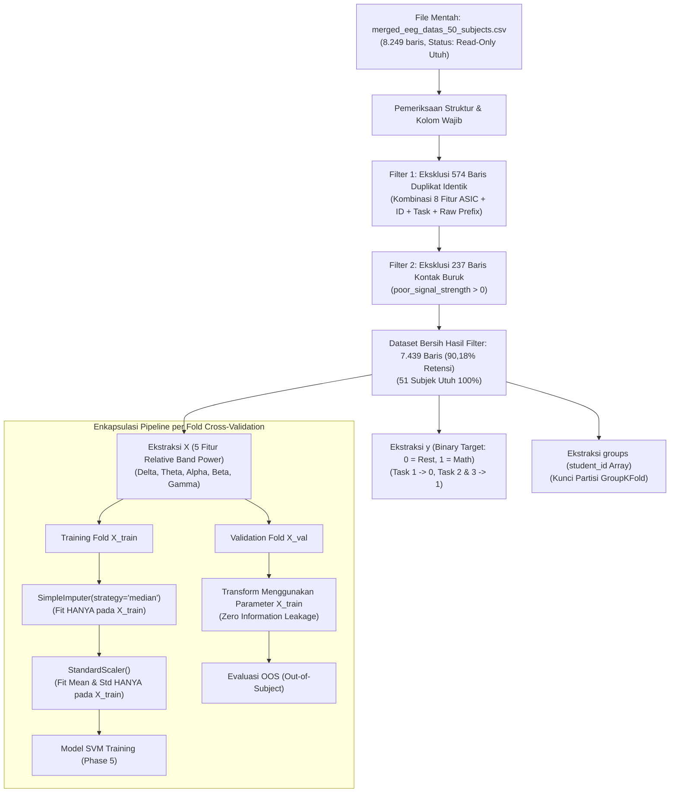

# DESAIN PREPROCESSING PIPELINE DAN SUBJECT-INDEPENDENT GROUPKFOLD VALIDATION
## Proyek Tugas Akhir: Rancang Bangun Perangkat IoT Wearable Berbasis EEG untuk Klasifikasi Pola Gelombang Otak Menggunakan Machine Learning

- **Penyusun**: Senior Machine Learning Engineer & Research Assistant (Tugas Akhir Renaldi)
- **Status Dokumen**: Laporan Resmi Phase 4 (Preprocessing & Validation Architecture)
- **Tanggal Selesai**: 2 November 2026
- **Modul Sumber**: `ml_service/src/preprocessing.py` & `ml_service/src/validation.py`
- **Artefak Audit**: `ml_service/reports/groupkfold_summary.json` & `ml_service/reports/groupkfold_subject_audit.csv`

---

## 1. TUJUAN DAN PRINSIP UTAMA PHASE 4

Phase 4 menetapkan arsitektur persiapan data dan validasi silang (*cross-validation*) dengan standar akademik sarjana terapan untuk mencegah **data leakage** (kebocoran data) dan **subject memorization** (model menghafal karakteristik individu, bukan pola gelombang otak).

```
+----------------------------------------------------------------------------------------------------+
|                                    PRINSIP PENCEGAHAN DATA LEAKAGE                                 |
+----------------------------------------------------------------------------------------------------+
| 1. PEMISAHAN TOTAL ANTAR-SUBJEK (Subject-Independent Split)                                        |
|    Data dari satu orang subjek (student_id) yang sama HANYA BOLEH berada di Training Set          |
|    ATAU di Validation Set pada fold yang bersangkutan, TIDAK PERNAH KEDUANYA.                      |
|                                                                                                    |
| 2. ENKAPSULASI SCIKIT-LEARN PIPELINE                                                               |
|    Transformasi data (Imputasi & StandardScaler) HANYA di-fit menggunakan sampel Training Fold.   |
|    Validation Fold hanya di-transformasi menggunakan mean dan varians dari Training Fold.          |
|                                                                                                    |
| 3. ISOLASI GROUPING VARIABLE                                                                       |
|    student_id murni digunakan sebagai Grouping Key untuk GroupKFold dan DIHAPUS dari matriks      |
|    fitur X, menjamin model tidak dapat mempelajari identitas subjek.                               |
+----------------------------------------------------------------------------------------------------+
```

---

## 2. ARSITEKTUR PREPROCESSING PIPELINE

Pipeline preprocessing diimplementasikan dalam modul [`ml_service/src/preprocessing.py`](file:///c:/Users/Renaldi/Documents/eeg-wearable-r/ml_service/src/preprocessing.py) melalui fungsi `load_and_filter_data()` dan `build_preprocessing_pipeline()`.



### A. Komponen Pipeline Scikit-learn
Pipeline yang dibangun menggunakan `build_preprocessing_pipeline()` memiliki struktur berurutan:
1. `imputer`: `SimpleImputer(strategy="median")`
   - Berfungsi sebagai jaring pengaman (*defensive guard*) untuk menjamin tidak ada nilai NaN/kosong saat inferensi.
2. `scaler`: `StandardScaler(copy=True, with_mean=True, with_std=True)`
   - Mentransformasi fitur $x$ menjadi z-score: $z = \frac{x - \mu_{\text{train}}}{\sigma_{\text{train}}}$.
   - Penskalaan fitur sangat krusial bagi Support Vector Machine (SVM) karena fungsi jarak kernel RBF $K(\mathbf{x}, \mathbf{x}') = \exp(-\gamma \|\mathbf{x} - \mathbf{x}'\|^2)$ sangat sensitif terhadap skala fitur.

### B. Uji Kebocoran Fitur Transformasi (Fold 1 Verification)
Pengujian eksekusi pada Fold 1 membuktikan integritas isolasi pipeline:
- **Parameter Mean Pelatihan** ($\mu_{\text{train}}$): `[2,7875, 14,2258, 27,8031, 27,4974, 27,6863]`
- **Parameter Skala Pelatihan** ($\sigma_{\text{train}}$): `[0,8805, 9,3532, 10,4424, 10,3548, 10,3456]`
- **Hasil Transformasi Training Set** ($X_{\text{train}}$): Mean $= [0, 0, 0, 0, 0]$, Std Dev $= [1, 1, 1, 1, 1]$
- **Hasil Transformasi Validation Set** ($X_{\text{val}}$): Mean $= [-0,0160, 0,0317, -0,0632, 0,0323, 0,0043]$
- *Analisis*: Nilai rata-rata pada validation set tidak persis nol karena dihitung menggunakan rata-rata training fold, membuktikan bahwa validation set **sama sekali tidak membocorkan informasi statistik** ke proses pelatihan (*zero data leakage*).

---

## 3. DESAIN VALIDASI SUBJECT-INDEPENDENT GROUPKFOLD (5 FOLDS)

Modul validasi diimplementasikan pada [`ml_service/src/validation.py`](file:///c:/Users/Renaldi/Documents/eeg-wearable-r/ml_service/src/validation.py).

### Mengapa Bukan `train_test_split` Biasa atau `StratifiedKFold`?
Pada rekaman biosinyal EEG kontinu, satu subjek menyumbang puluhan hingga ratusan baris data per detik. Jika menggunakan random split:
- Model akan mempelajari tanda tangan impedansi dan bentuk tengkorak spesifik subjek tertentu di training set, lalu dengan mudah "mengenali" orang yang sama di test set.
- Akurasi yang dihasilkan akan tampak tinggi semu (*over-optimistic pseudo-accuracy*), tetapi model akan langsung gagal total (*collapse*) ketika diuji pada orang baru.
- **GroupKFold** menjamin bahwa model diuji secara *Leave-Subjects-Out*, merepresentasikan kinerja sistem saat digunakan oleh pengguna baru yang belum pernah terekam sebelumnya.

### A. Rincian Metrik Partisi 5 Fold

```
+-------------------------------------------------------------------------------------------------------------------------+
|                                    RINGKASAN METRIK PARTISI SUBJECT-INDEPENDENT 5-FOLD                                  |
+------+----------------------+--------------------+--------------------+--------------------+--------------------+-------+
| Fold | Sampel Pelatihan     | Subjek Latih       | Sampel Validasi    | Subjek Validasi    | Komposisi Validasi | Rasio |
| Ke-  | (Train Samples, %)   | (Train Subjs)      | (Val Samples, %)   | (Val Subjs)        | C0 (Rest) vs C1    | C0    |
+------+----------------------+--------------------+--------------------+--------------------+--------------------+-------+
|  1   | 5.951 sampel (80,0%) | 41 subjek (80,4%)  | 1.488 sampel (20,0%)| 10 subjek (19,6%) | C0: 462  \| C1: 1.026| 31,1% |
|  2   | 5.972 sampel (80,3%) | 40 subjek (78,4%)  | 1.467 sampel (19,7%)| 11 subjek (21,6%) | C0: 540  \| C1:   927| 36,8% |
|  3   | 5.941 sampel (79,9%) | 41 subjek (80,4%)  | 1.498 sampel (20,1%)| 10 subjek (19,6%) | C0: 556  \| C1:   942| 37,1% |
|  4   | 5.952 sampel (80,0%) | 41 subjek (80,4%)  | 1.487 sampel (20,0%)| 10 subjek (19,6%) | C0: 510  \| C1:   977| 34,3% |
|  5   | 5.940 sampel (79,9%) | 41 subjek (80,4%)  | 1.499 sampel (20,1%)| 10 subjek (19,6%) | C0: 514  \| C1:   985| 34,3% |
+------+----------------------+--------------------+--------------------+--------------------+--------------------+-------+
| Mean | 5.951 sampel (80,0%) | 40,8 subjek (80,0%)| 1.488 sampel (20,0%)| 10,2 subjek (20,0%)| Sangat Seimbang    | 34,7% |
+------+----------------------+--------------------+--------------------+--------------------+--------------------+-------+
```

*Keunggulan Distribusi Partisi*:
1. **Ukuran Sampel Validasi Sangat Seragam**: Setiap fold validasi memiliki antara **1.467 hingga 1.499 sampel** (rentang variasi $< 2\%$).
2. **Keterwakilan Kelas Konsisten**: Setiap fold validasi memuat kedua kelas dalam jumlah yang sangat memadai (462–556 sampel untuk Class 0 dan 927–1.026 sampel untuk Class 1).
3. **Proporsi Kelas Alami**: Rasio Class 0 pada setiap fold validasi berkisar antara $31,1\% - 37,1\%$, mendekati rasio populasi aslinya ($34,71\%$).

---

## 4. DAFTAR SUBJEK PER FOLD UNTUK TRANSPARANSI AUDIT KOLOKIUM

Daftar penugasan subjek ke dalam fold validasi disimpan secara permanen pada [`ml_service/reports/groupkfold_subject_audit.csv`](file:///c:/Users/Renaldi/Documents/eeg-wearable-r/ml_service/reports/groupkfold_subject_audit.csv):

```
+----------------------------------------------------------------------------------------------------+
|                                    ALOKASI VALIDATION FOLD PER SUBJEK                              |
+------+-----------+---------------------------------------------------------------------------------+
| Fold | Jml Subjek| Daftar ID Partisipan (student_id) di Validation Set                             |
+------+-----------+---------------------------------------------------------------------------------+
|  1   | 10 subjek | 1911018, 1911028, 2111023, 2211010, 2211014, 2302007, 2302087, 2304128,         |
|      |           | 2311024, 2311027                                                                |
+------+-----------+---------------------------------------------------------------------------------+
|  2   | 11 subjek | 1903020, 1911013, 1911019, 2104041, 2211022, 2211023, 2302032, 2306013,         |
|      |           | 2311004, 2311016, 2401001                                                       |
+------+-----------+---------------------------------------------------------------------------------+
|  3   | 10 subjek | 1910016, 1911017, 2011018, 2211015, 2302077, 2302128, 2304113, 2304127,         |
|      |           | 2311019, 2311026                                                                |
+------+-----------+---------------------------------------------------------------------------------+
|  4   | 10 subjek | 2011022, 2111013, 2211005, 2211024, 2301071, 2302069, 2311003, 2311005,         |
|      |           | 2311007, 2401002                                                                |
+------+-----------+---------------------------------------------------------------------------------+
|  5   | 10 subjek | 1909017, 1910013, 1911016, 2102090, 2111017, 2211021, 2304121, 2311006,         |
|      |           | 2311017, 2312002                                                                |
+------+-----------+---------------------------------------------------------------------------------+
```

*(Catatan Khusus Subjek 1911019)*: Subjek ini (yang hanya memiliki rekaman Task 1 sebanyak 61 detik) dialokasikan pada Validation Fold 2. Sifat GroupKFold memastikan data subjek ini tidak mencemari training set pada fold lainnya.

---

## 5. VERIFIKASI OTOMATIS ANTI-LEAKAGE (*AUTOMATED ASSERTION*)

Fungsi `verify_no_group_leakage()` pada `ml_service/src/validation.py` mengeksekusi pemeriksaan irisan himpunan matematis secara otomatis pada setiap iterasi:

```python
for fold_idx, (train_idx, val_idx) in enumerate(splits, start=1):
    train_subjs = set(groups[train_idx])
    val_subjs = set(groups[val_idx])
    overlap = train_subjs.intersection(val_subjs)
    assert len(overlap) == 0, f"DATA LEAKAGE DETECTED: {overlap}"
```

### Hasil Eksekusi Uji:
- **Status Uji**: `PASSED_ZERO_LEAKAGE`
- **Total Irisan Subjek Fold 1 s.d. 5**: `0 subjek (Overlap = ∅)`
- **Jaminan Metodologis**: Tidak ada satu pun baris data dari subjek yang sedang diuji yang pernah dilihat oleh model pada fase training.

### Batasan Cakupan Jaminan Anti-Leakage (Scope of Zero Leakage Guarantee)
Perlu dipertegas secara metodologis bahwa verifikasi `PASSED_ZERO_LEAKAGE` yang dibuktikan di atas secara spesifik menjamin **Zero Subject Overlap (Pemisahan Subjek Independen)**.
Artinya:
1. Terbukti secara matematis bahwa tidak ada data dari subjek uji yang bocor ke training fold dalam proses standarisasi (`StandardScaler`) maupun partisi data (`GroupKFold`).
2. Namun, hal ini **TIDAK BOLEH DIANGGAP SEBAGAI JAMINAN MUTLAK** bahwa seluruh kemungkinan bentuk kebocoran sistemik eksternal sudah tertutup 100%. Risiko pembaur intrinsik pada dataset primer—seperti efek fisiologis pembukaan mata (*Berger Effect*), autokorelasi temporal deret waktu per detik, atau normalisasi proprietary internal chip ThinkGear ASIC sebelum data dicatat—tetap menjadi batasan bawaan dataset publik yang wajib disampaikan secara transparan pada sidang Kolokium.

---

## 6. KEPATUHAN TERHADAP BATASAN KERJA

Pada Phase 4 ini, seluruh batasan dipatuhi secara ketat:
- [x] **Tidak ada pelatihan model SVM** yang dijalankan.
- [x] **Tidak ada hyperparameter tuning** ($C$ atau $\gamma$) yang dijalankan.
- [x] **Tidak ada pemilihan kernel terbaik** yang dilakukan.
- [x] **Tidak ada klaim akurasi model** yang dipublikasikan.
- [x] **Target klasifikasi biner dan 5 fitur baseline tidak diubah**.

---

## 7. KESIMPULAN DAN KESIAPAN MENUJU PHASE 5

Arsitektur Preprocessing Pipeline dan Subject-Independent GroupKFold telah beroperasi secara stabil, terverifikasi bebas kebocoran, dan siap digunakan sebagai dasar evaluasi model pada **PHASE 5 (Implementasi Model SVM Baseline & Tuning)**.

