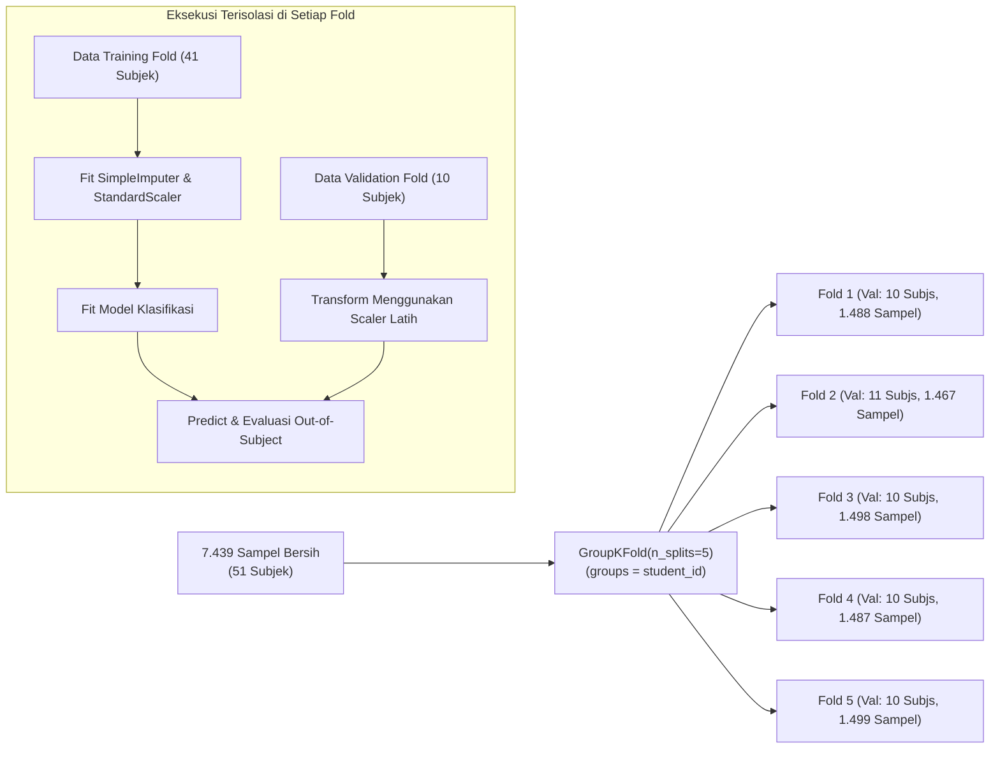

# RANCANGAN METODOLOGI EKSPERIMEN MACHINE LEARNING PHASE 5
## Proyek Tugas Akhir: Rancang Bangun Perangkat IoT Wearable Berbasis EEG untuk Klasifikasi Pola Gelombang Otak Menggunakan Machine Learning

- **Penyusun**: Senior Machine Learning Engineer, Data Scientist & Research Assistant (Tugas Akhir Renaldi)
- **Status Dokumen**: Dokumen Rencana Eksperimen Resmi Phase 5 (Methodology Action Plan)
- **Tanggal Dokumen**: 2 November 2026
- **Dokumen Acuan**: [`ml_service/docs/KOLOKIUM_ML_GUIDE.md`](file:///c:/Users/Renaldi/Documents/eeg-wearable-r/ml_service/docs/KOLOKIUM_ML_GUIDE.md) & [`ml_service/docs/kolokium_ml_alignment_review.md`](file:///c:/Users/Renaldi/Documents/eeg-wearable-r/ml_service/docs/kolokium_ml_alignment_review.md)

---

## 1. TUJUAN EKSPERIMEN PHASE 5

Eksperimen Phase 5 dirancang secara sederhana, terukur, dan realistis untuk menjawab pertanyaan metodologis Tugas Akhir:
1. **Menguji Hipotesis Separabilitas Non-linear**: Membuktikan secara empiris apakah pemetaan ruang Hilbert pada Support Vector Machine dengan Kernel RBF memberikan margin pemisah yang lebih baik daripada model linear sederhana (Logistic Regression & SVM Linear).
2. **Menetapkan Batas Bawah Objektif**: Membandingkan performa model terhadap Dummy Classifier untuk membongkar ilusi akurasi semu akibat ketidakseimbangan kelas.
3. **Mengevaluasi Generalisasi Out-of-Subject**: Mengukur kemampuan model memprediksi kondisi eksperimen pada individu baru (*leave-subjects-out*) menggunakan partisi 5-Fold GroupKFold yang telah diverifikasi bebas kebocoran.

---

## 2. SPESIFIKASI DATASET & VEKTOR FITUR MASUKAN

```
+----------------------------------------------------------------------------------------------------+
|                                    SPESIFIKASI DATASET & FITUR MASUKAN                             |
+--------------------------+-------------------------------------------------------------------------+
| Parameter                | Konfigurasi Metodologis Eksperimen                                      |
+--------------------------+-------------------------------------------------------------------------+
| Sumber Data              | Mendeley Data (CUET 2025, DOI: 10.17632/gy4sbnn389.1)                   |
| Peran Sumber Data        | Studi kelayakan metodologis pra-alat (Preliminary Feasibility Study)    |
| Jumlah Sampel Bersih     | Tepat 7.439 rekaman detik (90,18% retensi pasca-filtering)             |
| Jumlah Partisipan        | 51 subjek unik (100% terwakili pasca-filtering)                        |
| Fitur Masukan X (D = 5)  | 1. neuro_relative_delta (0.5 - 4.0 Hz, %)                               |
|                          | 2. neuro_relative_theta (4.0 - 8.0 Hz, %)                               |
|                          | 3. neuro_relative_alpha (8.0 - 13.0 Hz, %)                              |
|                          | 4. neuro_relative_beta (13.0 - 30.0 Hz, %)                              |
|                          | 5. neuro_relative_gamma (30.0 - 50.0 Hz, %)                             |
| Target Klasifikasi (y)   | Biner: 0 = Closed-Eye Resting Baseline (Task 1, 2.582 sampel / 34,71%)  |
|                          |        1 = Active Mathematical Tasks (Task 2 & 3, 4.857 sampel / 65,29%)|
| Larangan Fitur           | MAX30102 (BPM/SpO2), TBR, workload_score, is_correct, dan created_at   |
|                          | DILARANG KERAS dimasukkan ke dalam model X.                             |
+--------------------------+-------------------------------------------------------------------------+
```

---

## 3. MODEL YANG DIBANDINGKAN & KONFIGURASI PARAMETER

Sesuai arahan panduan kolokium, eksperimen difokuskan pada perbandingan 4 model terstruktur tanpa memperluas ruang lingkup secara berlebihan:

| No | Model Algoritma | Peran dalam Penelitian | Konfigurasi Parameter Default | Justifikasi Metodologis |
|---|---|---|---|---|
| 1 | **Dummy Classifier** | Baseline Peluang Acak (*Chance-level*) | `strategy="most_frequent"` | Membuktikan batas bawah tebakan kelas mayoritas ($65,29\%$) guna menguji apakah model ML benar-benar belajar atau hanya menebak kelas dominan. |
| 2 | **Logistic Regression** | Pembanding Linear Sederhana | `penalty="l2"`, `C=1.0`, `class_weight="balanced"`, `max_iter=1000` | Menguji apakah batas keputusan antar-kondisi tugas dapat dipisahkan secara linear di ruang fitur Euclidean. |
| 3 | **SVM Linear** | Pembanding Garis Batas Optimal Linear | `kernel="linear"`, `C=1.0`, `class_weight="balanced"`, `probability=True` | Menemukan hyperplane pemisah optimal dengan margin linear tanpa transformasi non-linear. |
| 4 | **SVM RBF** | **Model Utama Penelitian TA** | `kernel="rbf"`, `C=1.0`, `gamma="scale"`, `class_weight="balanced"`, `probability=True` | Memetakan fitur biosinyal ke ruang dimensi tak terhingga untuk menguji separabilitas non-linear. |

---

## 4. PROTOKOL VALIDASI & ISOLASI DATA LEAKAGE



### Jaminan Keabsahan Metodologis:
1. **Zero Subject Overlap**: Verifikasi matematis $\text{Train Subjects}_k \cap \text{Val Subjects}_k = \emptyset$ telah terbukti pada kelima fold.
2. **Encapsulated Pipeline**: `StandardScaler` dan `SimpleImputer` di-fit **HANYA** pada data latih masing-masing fold.
3. **Pemisahan Group Key**: Kolom `student_id` murni dijadikan kunci pengelompokan (*grouping variable*) dan **tidak pernah disertakan sebagai fitur input $X$**.

---

## 5. METRIK EVALUASI DAN ATURAN PELAPORAN

Pelaporan performa model wajib mematuhi kaidah evaluasi multi-metrik:

1. **Balanced Accuracy**: Metrik utama pengambil keputusan performa karena mengimbangi ketidakseimbangan proporsi kelas ($34,7\%$ vs $65,3\%$).
2. **Macro F1-Score**: Rerata F1-Score tanpa pembobotan frekuensi untuk memastikan model mampu mendeteksi kondisi istirahat maupun pengerjaan matematika secara adil.
3. **Precision & Recall per Kelas**: Khususnya **Recall Kelas 0 (Resting)** untuk membuktikan apakah model mampu mengenali kondisi rileks tanpa bias ke kelas mayoritas.
4. **ROC-AUC**: Mengukur kualitas pemisahan probabilitas keputusan model.
5. **Confusion Matrix Lengkap**: Disajikan dalam bentuk tabel agregat $[[\text{TN}, \text{FP}], [\text{FN}, \text{TP}]]$.
6. **Pelaporan Rerata & Standar Deviasi**: Seluruh metrik dilaporkan dalam format $\mu \pm \sigma$ dari kelima fold pengujian.

---

## 6. KEBIJAKAN TUNING HIPERPARAMETER (NESTED GROUPED CV)

Sesuai instruksi Anda untuk menjaga kesederhanaan dan keabsahan ilmiah:
1. **Prioritas Eksperimen**: Eksperimen **baseline** dengan parameter default terstandarisasi dilaporkan terlebih dahulu secara transparan.
2. **Aturan Penyetelan Lanjutan (*Nested CV*)**:
   - Jika tuning parameter ($C$ dan $\gamma$) akan dieksekusi, proses pencarian parameter terbaik **WAJIB DILAKUKAN di dalam inner-fold training** (Nested GroupKFold) dan tidak boleh melihat data validation fold luar.
   - Ruang pencarian dibatasi secara realistis: $C \in [0.1, 1.0, 10.0]$ dan $\gamma \in ['scale', 'auto', 0.1]$.
   - Mencegah optimasi berlebihan (*over-tuning*) yang tidak relevan dengan kapasitas representasi sensor kanal tunggal.

---

## 7. BATASAN PENELITIAN & INTEGRITAS AKADEMIS

1. **Batasan Dataset Publik**:
   - Perekaman dataset publik Mendeley dilakukan pada 51 mahasiswa di Bangladesh menggunakan perangkat komersial NeuroSky MindWave Mobile dengan koneksi Bluetooth.
   - Hasil evaluasi model pada dataset publik ini berkedudukan sebagai **studi kelayakan algoritma dan pipeline awal**, bukan bukti bahwa sistem IoT hardware mandiri telah selesai diuji.
2. **Batasan Klaim Hasil**:
   - Dilarang keras mengklaim model mampu mengukur "tingkat fokus", "kecerdasan", "tingkat stres", atau "kondisi mental internal".
   - Model secara sah hanya mengklasifikasikan respons gelombang otak terhadap **dua kondisi eksperimental terkontrol (kondisi istirahat mata tertutup vs pengerjaan tugas matematika)**.
3. **Integritas Judul & Ruang Lingkup**:
   - Judul Tugas Akhir: *"Rancang Bangun Perangkat IoT Wearable Berbasis EEG untuk Klasifikasi Pola Gelombang Otak Menggunakan Machine Learning"*.
   - Ruang lingkup tetap terfokus pada integrasi biosensing EEG kanal tunggal, mikrokontroler ESP32, microservice Python SVM, backend Go, dan dashboard Next.js tanpa perluasan yang tidak disetujui pembimbing.

---

*Rencana metodologi Phase 5 ini telah dirumuskan secara terstruktur, terikat pada prinsip-prinsip akademis `KOLOKIUM_ML_GUIDE.md`, dan siap dieksekusi setelah mendapatkan persetujuan resmi Anda.*

